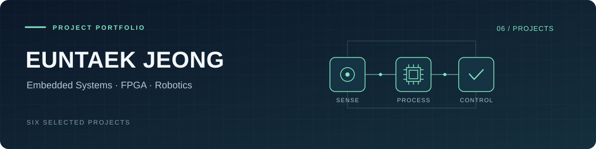

  

# EUNTAEK JEONG · 프로젝트 포트폴리오

전자공학에서 배운 신호처리·디지털회로·제어·AI를 실제 장치로 연결한 대표 프로젝트 6개를 정리했습니다. 프로젝트 이름을 누르면 설계, 문제 해결 과정, 코드와 시연·사진 자료를 볼 수 있습니다.

## 종합설계

### [FPGA 기반 드론 탐지·추적](https://github.com/jounget5411-lab/fpga-drone-portfolio)

카메라 입력부터 AI 추론과 팬틸트 제어까지 하나의 FPGA SoC에 통합했습니다. SNN으로 움직임을 감시하고, 후보가 나타나면 CNN으로 위치를 검출해 추적하는 구조입니다.

**핵심 기술** · Zynq · Verilog · C/C++ · AXI/VDMA · SNN · INT8 CNN · 팬틸트 제어

## 임베디드 시스템

| 프로젝트 | 구현 내용 | 핵심 기술 |
|---|---|---|
| [음성인식 기반 비접촉 조명 제어](https://github.com/jounget5411-lab/embedded-voice-lighting-portfolio) | 두 MCU에서 음성 특징 추출과 정수 추론을 나누고, 근접 조건에 따라 조명 제어 | Arduino · DSP · 정수 추론 · SPI/UART · PWM |
| [음원 방향 추정·센서 기반 수어 번역](https://github.com/jounget5411-lab/embedded-sensor-fusion-portfolio) | 세 STM32 보드에서 음원 방향과 센서 장갑의 동작을 분석해 LED·LCD로 전달 | STM32 · ADC/DMA · TDOA · IMU · 센서 특징 분류 |
| [접근 이벤트 기반 사진 판별·선별 저장](https://github.com/jounget5411-lab/embedded-intrusion-detection-portfolio) | 접근 시 촬영한 사진을 Zynq에서 판별하고 낯선 사람의 사진만 저장 | STM32 · Zynq PS · FreeRTOS · SPI/DMA · C 추론 · FatFs |

## 자율주행

| 프로젝트 | 구현 내용 | 핵심 기술 |
|---|---|---|
| [국민대학교 자율주행 경진대회](https://github.com/jounget5411-lab/kookmin-autonomous-driving-portfolio) | 카메라·LiDAR 정보를 경로로 변환하고 실차의 조향·속도 제어에 연결 | ROS · Python · OpenCV · CNN · OpenVINO · 주행 제어 |
| [HL FMA 2025 자율주행](https://github.com/jounget5411-lab/hlfma-2025-portfolio) | 개조 차량에서 GPS 경로와 차량 방향의 기준을 맞추고 미션별 구동 조건 적용 | ROS 2 · GNSS/IMU · 좌표 변환 · 경로 추종 · Arduino |
